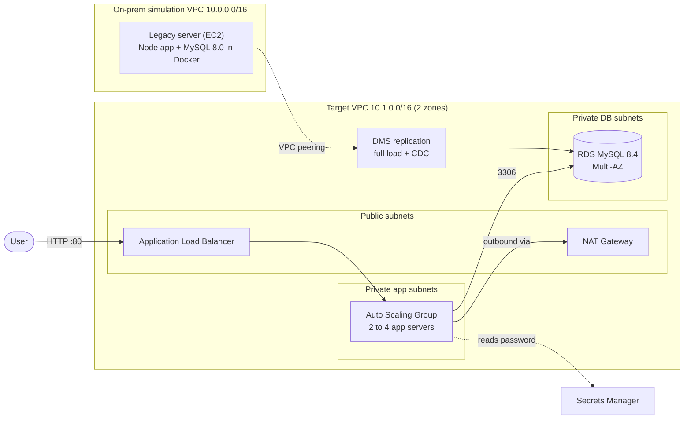

# AWS Migration Lab: legacy 3-tier app to a highly available AWS architecture

I migrated and modernized a legacy Node.js and MySQL app from a single "on-prem" server to a 2-zone, 3-tier AWS architecture, with all infrastructure in Terraform. I then broke it on purpose to prove it recovers.

**Region:** `ca-central-1` (Montreal) · **IaC:** Terraform · **Cost:** built and destroyed each session, under $5 in total

## Results

| What | Result |
|---|---|
| Cutover downtime (RTO) | **215 seconds** |
| Data lost (RPO) | **0** (DMS full load plus ongoing replication) |
| App server killed under live traffic | Recovered in about 20 s, replaced automatically, no human action |
| Forced RDS Multi-AZ failover | About 13 s of errors, no data lost, **no app restart** |
| Security problems found and fixed | 3 SQL injections, hardcoded password, 8 vulnerable packages |

## Architecture



**Request path:** user → load balancer (public subnets) → app servers (private) → RDS (private). Only the load balancer is reachable from the internet. Servers have no SSH; I use Session Manager.

## What I did, step by step

| Step | What | Build log |
|---|---|---|
| 1 | Ran the legacy app locally, assessed it, fixed SQL injection and outdated packages | [01](docs/build-log/01-local-run.md) |
| 2 | Account readiness, IAM, budget alerts in Terraform | [02](docs/build-log/02-aws-setup.md) |
| 3 | Built the "on-prem" VPC and legacy server entirely from user data | [03](docs/build-log/03-onprem-network.md), [04](docs/build-log/04-legacy-server.md) |
| 4 | Built the 2-zone, 3-tier target network | [05](docs/build-log/05-target-network.md) |
| 5 | RDS MySQL 8.4 with the password in Secrets Manager | [06](docs/build-log/06-target-database.md) |
| 6 | VPC peering and DMS: full load, then ongoing replication (CDC) | [07](docs/build-log/07-dms-migration.md) |
| 7 | App code for RDS (`mysql2` pool with retries), NAT, load balancer, Auto Scaling | [08](docs/build-log/08-app-code-for-rds.md), [09](docs/build-log/09-app-tier.md) |
| 8 | Cutover following a written runbook | [10](docs/build-log/10-cutover.md), [runbook](docs/runbooks/cutover.md) |
| 9 | Resilience tests: killed a server, forced a database failover | [11](docs/build-log/11-resilience-tests.md) |

## Modernization: legacy problems and fixes

| Problem in the legacy app | Fix |
|---|---|
| Database password hardcoded in code | RDS-managed password in Secrets Manager, read at boot by an IAM role scoped to that one secret |
| SQL injection (3 places, one could wipe the table) | Parameterized queries |
| Single connection, crashed if the database dropped | `mysql2` connection pool with retries, proven by a Multi-AZ failover |
| 8 vulnerable packages | Updated, `npm audit` clean |
| Crash bugs on bad input | Errors return a response instead of killing the process |

Full assessment: [docs/legacy-assessment.md](docs/legacy-assessment.md)

## Key decisions

- [ADR 001: Region](docs/adr/001-region.md): `ca-central-1` for Canadian data residency
- [ADR 002: MySQL 8.4](docs/adr/002-mysql-version.md): 8.0 left standard support, so the migration also upgrades the database
- [ADR 003: Outbound internet](docs/adr/003-outbound-internet.md): one NAT Gateway, and the trade-off versus one per zone

## Repo layout

```
app/app-tier/        Node.js API (Express + mysql2)
infra/bootstrap/     Budgets (stays deployed)
infra/onprem/        Simulated on-prem VPC and legacy server
infra/target/        Target VPC, RDS, NAT, load balancer, Auto Scaling
infra/migration/     VPC peering and DMS
docs/                Build logs, ADRs, runbook, assessment, screenshots
```

## Run it yourself

Each folder is a separate Terraform root. Build in order, destroy in reverse:

```bash
cd infra/onprem    && terraform apply   # legacy server
cd ../target       && terraform apply   # new architecture
cd ../migration    && terraform apply   # peering + DMS
# ...migrate and cut over (docs/runbooks/cutover.md)...
cd ../migration && terraform destroy
cd ../target    && terraform destroy
cd ../onprem    && terraform destroy
```

You need a `terraform.tfvars` in each folder (`my_ip`, passwords); those files are gitignored.

## What I'd do next in production

- One NAT Gateway per zone, and faster health checks with client retries
- HTTPS on the load balancer with an ACM certificate and a custom domain
- A schema migration tool (Flyway or Liquibase) instead of `CREATE TABLE IF NOT EXISTS` at boot
- Remote Terraform state in S3 with locking, and a CI/CD pipeline for `plan` and `apply`

## Credits

The starting application comes from the AWS sample [aws-three-tier-web-architecture-workshop](https://github.com/aws-samples/aws-three-tier-web-architecture-workshop) (MIT-0). The assessment, fixes, Terraform, migration and testing are my own work.
